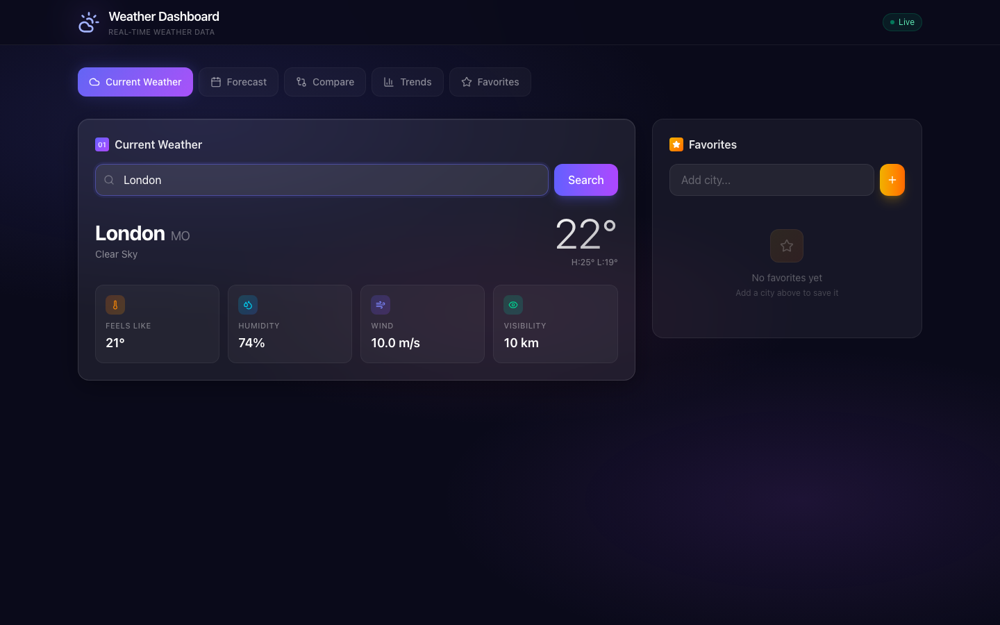
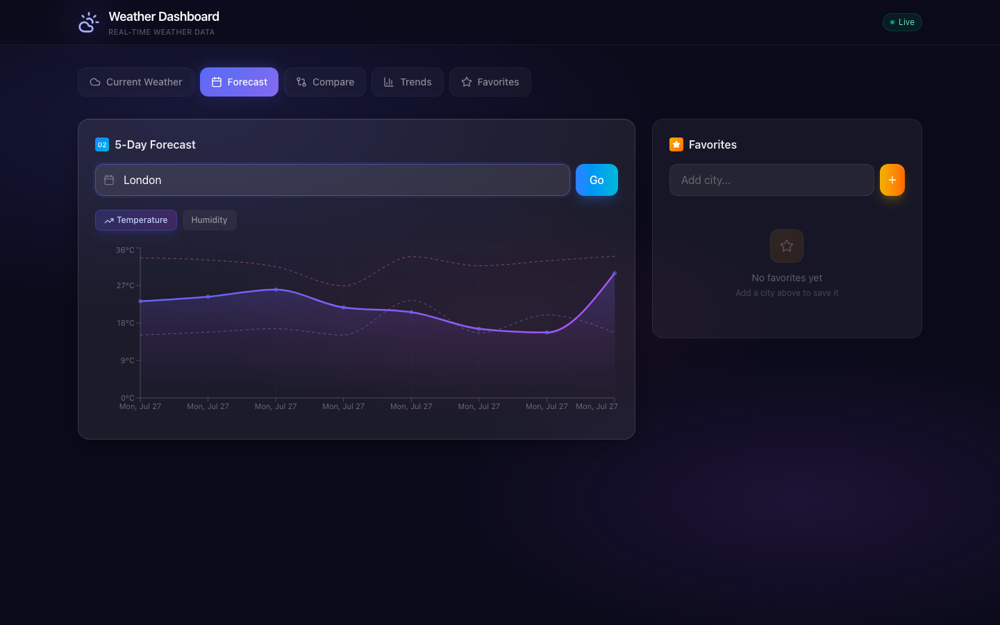
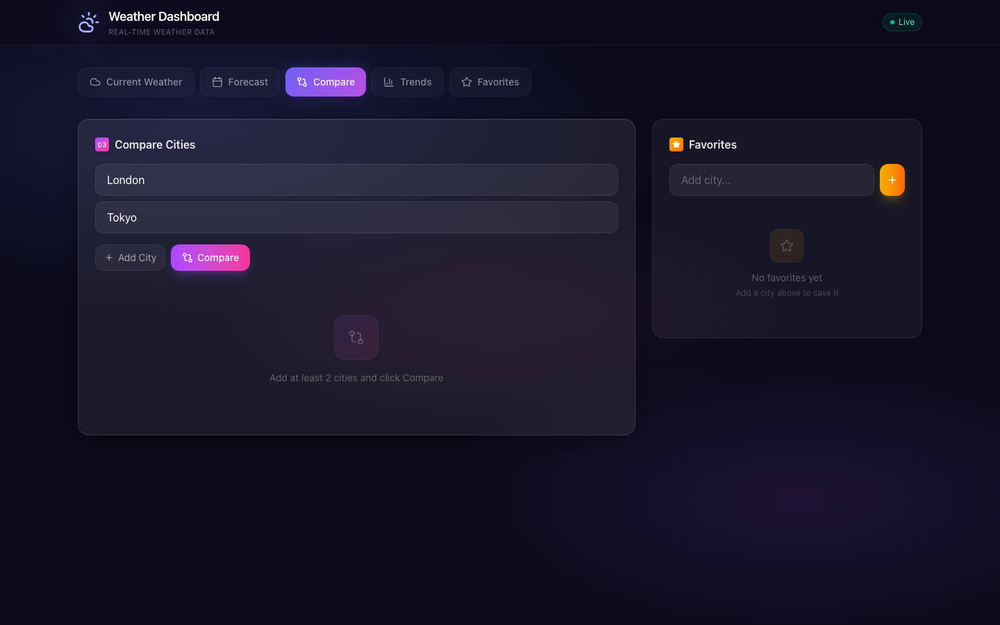
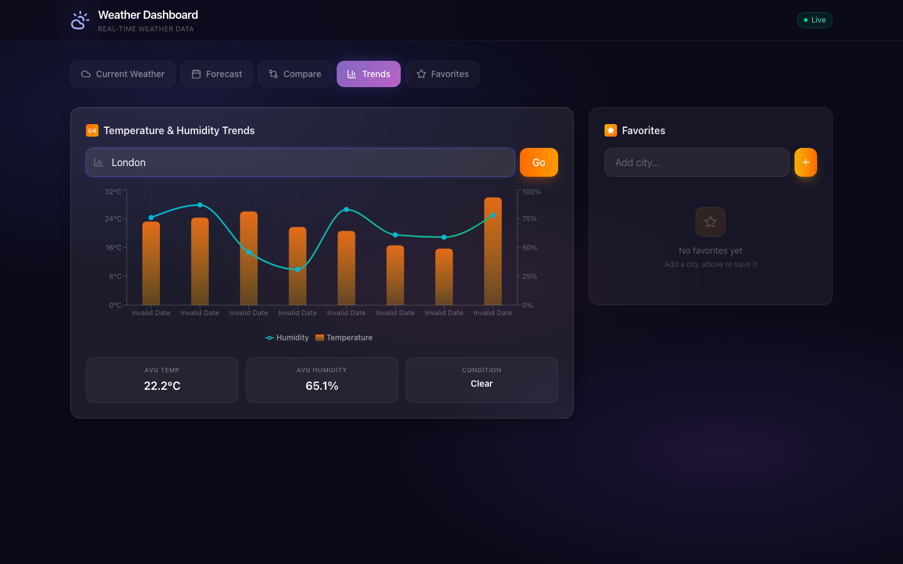
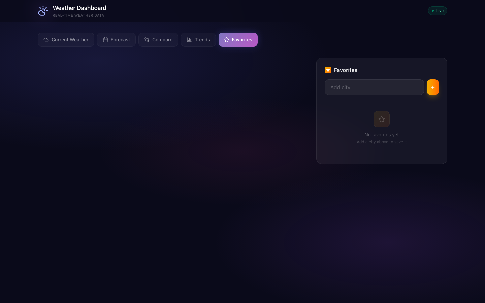

# Weather Analysis API

Production-ready FastAPI service for analyzing weather data, powered by OpenWeatherMap.

## Features

- **Current weather** — real-time conditions for any city
- **5-day forecast** — hourly breakdowns with precipitation probability
- **City comparison** — side-by-side weather across multiple locations
- **Trend analysis** — temperature and humidity patterns
- **Favorites** — save and manage your preferred cities
- **Caching** — Redis (production) or in-memory (development)
- **Rate limiting** — configurable per-IP request throttling
- **Mock mode** — works without an API key for development

## Quick Start

```bash
# Clone and install
cd weather-api
python -m venv .venv && source .venv/bin/activate
pip install -e ".[dev]"

# Run (mock mode — no API key needed)
cp .env.example .env
uvicorn app.main:app --reload

# Run with real data
echo "OPENWEATHER_API_KEY=your_key_here" >> .env
uvicorn app.main:app --reload
```

## Docker

```bash
docker compose up --build
```

## API Endpoints

| Method | Path | Description |
|--------|------|-------------|
| `GET` | `/api/v1/weather/current/{city}` | Current weather |
| `GET` | `/api/v1/weather/forecast/{city}` | 5-day forecast |
| `GET` | `/api/v1/weather/history/{city}?days=7` | Historical data |
| `POST` | `/api/v1/weather/compare` | Compare cities |
| `GET` | `/api/v1/weather/analysis/trends?city=London` | Temperature trends |
| `POST` | `/api/v1/favorites` | Add favorite |
| `GET` | `/api/v1/favorites` | List favorites |
| `DELETE` | `/api/v1/favorites/{id}` | Remove favorite |
| `GET` | `/health` | Health check |

## Development

```bash
# Run tests
pytest -v

# Lint
ruff check .
ruff format .

# Type check
mypy app/
```

## Configuration

| Variable | Default | Description |
|----------|---------|-------------|
| `OPENWEATHER_API_KEY` | (empty = mock mode) | OpenWeatherMap API key |
| `DATABASE_URL` | `sqlite+aiosqlite:///./weather.db` | Database connection string |
| `REDIS_URL` | (empty = in-memory cache) | Redis connection URL |
| `DEBUG` | `false` | Enable debug mode |
| `ALLOWED_ORIGINS` | `["*"]` | CORS allowed origins |

## Project Structure & Architecture

### Backend (FastAPI)
```
app/
├── main.py              # App factory, lifespan
├── config.py            # Settings via pydantic-settings
├── dependencies.py      # Dependency injection factories
├── core/                # Database, exceptions, logging, middleware
│   ├── database.py      # SQLAlchemy connection pool
│   ├── exceptions.py    # Custom exception handlers
│   ├── logging.py       # Structured logging
│   └── middleware.py    # Request/response middleware
├── models/              # SQLAlchemy ORM
│   ├── city.py          # City entity
│   ├── weather_data.py  # Weather data entity
│   └── favorite.py      # Favorite city entity
├── schemas/             # Pydantic v2 models
│   ├── weather.py       # Weather response schemas
│   ├── forecast.py      # Forecast schemas
│   └── favorites.py     # Favorite schemas
├── services/            # Business logic layer
│   ├── weather.py       # Weather data fetching & processing
│   ├── analysis.py      # Data analysis & aggregation
│   ├── favorites.py     # Favorite city management
│   └── caching.py       # Redis/in-memory caching
├── routers/             # HTTP endpoint handlers
│   ├── weather.py       # Weather endpoints
│   ├── forecast.py      # Forecast endpoints
│   └── favorites.py     # Favorites endpoints
└── utils/               # Helpers
    ├── cache.py          # Caching utilities
    ├── validation.py     # Input validation
    └── monitoring.py     # Health checks & metrics
```

### Frontend (React/Vite)
```
frontend/
├── src/
│   ├── components/      # Reusable UI components
│   │   ├── dashboard/   # Dashboard specific components
│   │   ├── charts/      # Chart components (Recharts)
│   │   └── forms/       # Form components
│   ├── pages/          # Page components
│   │   ├── Dashboard/   # Main dashboard page
│   │   ├── Weather/    # Weather detail page
│   │   └── Favorites/  # Favorites page
│   ├── services/       # API service layer
│   │   ├── auth.js      # Authentication service
│   │   ├── weather.js   # Weather API service
│   │   └── favorites.js # Favorites API service
│   ├── hooks/          # Custom React hooks
│   │   ├── useWeather  # Weather data hooks
│   │   └── useFavorites # Favorites hooks
│   ├── stores/         # Zustand stores
│   │   ├── weatherStore # Weather data store
│   │   └── favoritesStore # Favorites store
│   ├── utils/          # Utility functions
│   │   ├── api.js       # API call utilities
│   │   └── format.js   # Date/number formatting
│   └── App.jsx         # Root component
├── assets/              # Static assets
├── components/          # Shared component definitions
└── types/              # TypeScript types
```

### Architecture Flow
```
┌───────────────────┐     ┌───────────────────┐     ┌───────────────────┐
│   Frontend UI     │ ◄─► │   Frontend API    │ ◄─► │    Backend API    │
│   (React/Vite)    │     │   (Axios/WS)      │     │     (FastAPI)     │
└───────────────────┘     └───────────────────┘     └───────────────────┘
            │                                         │
            ▼                                         ▼
┌───────────────────┐                     ┌────────────────────────┐
│   WebSocket       │                     │    Caching Layer       │
│   (realtime)      │                     │    (Redis/Memory)      │
└───────────────────┘                     └────────────────────────┘
            │                                         │
            └─────────────────────────────────────────┘
                              │
                              ▼
                    ┌────────────────────────┐
                    │   Database Layer       │
                    │   (SQLite/Postgres)    │
                    └────────────────────────┘
```

### Key Technologies

| Layer | Technologies | Purpose |
|-------|-------------|---------|
| **Frontend** | React, Vite, TailwindCSS 4, Recharts, Zustand | UI & client-side state |
| **Backend** | FastAPI, SQLAlchemy, Pydantic v2 | API & business logic |
| **Cache** | Redis (prod), In-memory (dev) | Performance optimization |
| **Database** | SQLite (dev), PostgreSQL (prod) | Data persistence |
| **Auth** | OpenWeatherMap API, JWT tokens | Weather data source |
| **Monitoring** | Health checks, structured logging, metrics | Observability |

### Deployment Architecture

```
┌─────────────────────────────────────────────────────────────────────────────┐
│                        Production Deployment Stack                        │
├─────────────────────────────────────────────────────────────────────────────┤
│ Frontend (Vercel/Cloudflare)    ──────────────────────    Backend (Dockerized) │
│                                                                            │
│ ┌─────────────────┐    ┌─────────────────┐    ┌─────────────────┐          │
│ │ CDN Assets      │    │   Load Balancer  │    │  Container      │          │
│ │ (Static Files)  │───►│ (nginx/Traefik)  │───►│  Orchestration  │          │
│ └─────────────────┘    └─────────────────┘    └─────────────────┘          │
│                                                                          │
│ ┌─────────────────┐    ┌─────────────────┐                              │
│ │ Monitoring      │◄────┤  Backend        │                              │
│ │ & Logging       │    │  Services       │                              │
│ └─────────────────┘    │  ────────────────┤                              │
│                       │  │ API Services    │                              │
│                       │  ├───────────────┐│                              │
│                       │  │ Workers        ││                              │
│                       │  ├───────────────┐│                              │
│                       │  │ Queue/Tasks    ││                              │
│                       │  └───────────────┘│                              │
└───────────────────────┴───────────────────┴───────────────────────────────┘
                                           │
                                           ▼
                                   ┌─────────────────┐
                                   │ Infrastructure  │
                                   │ (Kubernetes)    │
                                   └─────────────────┘
                                   │        │
                                   ▼        ▼
                           ┌─────────────────┐  ┌─────────────────┐
                           │  Load Balancer   │  │  Monitoring     │
                           │  (External)      │  │  & Observability │
                           └─────────────────┘  └─────────────────┘
```

## Dashboard UI

A modern React dashboard built with Vite, TailwindCSS v4, and Recharts.

### Running the Dashboard

```bash
# Terminal 1 — Backend
cd weather-api
source .venv/bin/activate
uvicorn app.main:app --port 8000

# Terminal 2 — Frontend
cd weather-api/frontend
npm install
npm run dev
```

Open **http://localhost:5173**

### Screenshots

**Current Weather** — Search any city to see real-time conditions with temperature, humidity, wind speed, and visibility.



**5-Day Forecast** — Interactive area chart showing temperature and humidity trends over the next 5 days.



**City Comparison** — Radar chart comparing multiple cities across temperature, humidity, and wind speed.



**Trends** — Combined bar and line chart visualizing temperature and humidity patterns with summary stats.



**Favorites** — Save your favorite cities for quick access. Click any favorite to load its weather data.


